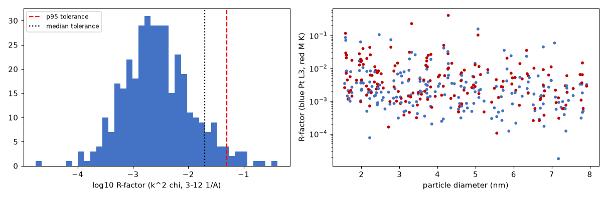
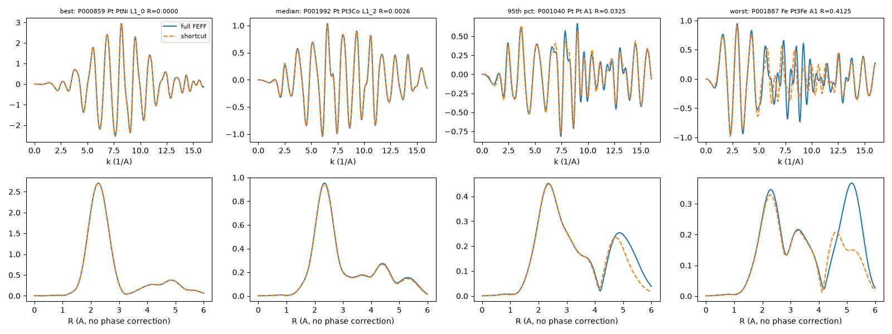

# EXAFS shortcut validation

**Verdict: PASS.** On 372 (sample, edge) pairs from 200 random samples, the shortcut χ(k) differs from full FEFF6L by a median R-factor of 0.0025 (tolerance 0.02), 95th percentile 0.0338 (tolerance 0.05), worst 0.413; median first-shell |χ(R)| peak error 1.5 % (tolerance 5 %), median peak-position error 0.000 Å (tolerance 0.02 Å).

## What is validated

The dataset's χ(k) is not computed with FEFF per sample. It is synthesized from each particle's absorber-centred partial distance distributions (single scattering, r ≤ 6 Å) and from multiple-scattering paths of bulk FEFF runs of the same composition and phase, rescaled to the particle (`forge/exafs.py`):

- **Single scattering:** every 0.004 Å distance bin is a path with the FEFF amplitude, phase, Re(p) and mean free path of the nearest reference shell from the bulk run of the same composition / phase (pair runs as fallback), placed at the bin distance through ΔR (larch path equation).
- **Multiple scattering:** each bulk FEFF path (NLEG ≤ 4, half path ≤ 6 Å) is matched to a *motif*: species and neighbour shells of its 1–2 distinct scatterers and their mutual distance. Its degeneracy is scaled by the particle/bulk motif count. Its length is scaled by the particle/bulk mean motif length, and its σ² gets the particle's static motif variance. Paths with 3 distinct scatterers, about 5% of the MS amplitude, use a shell-occupancy rule.
- **Thermal disorder** uses the same correlated model as the Debye calculations (σ² = (U_a + U_b)·max(0.35, 1 − δ2/R²)).

## Protocol

- 200 samples drawn at random (seed 8) from the pilot plan (all compositions, phases, shapes, sizes and faults); none of them was used during development.
- Per sample and edge (Pt L3; M K for alloys) up to 8 random absorbers. Each absorber's cluster (atoms within 7.5 Å) is run through FEFF6L (xraylarch 2026.3.1) with RMAX 6.0 Å, NLEG 4 and no path filter (CRITERIA 0 0). χ(k) is summed over all paths with the same thermal model and averaged over the absorbers. S0² = 1 on both sides.
- The shortcut is evaluated on exactly the same absorbers and geometry (their own partial distributions and motif statistics). Clusters that hit FEFF6's path-hash collision were re-run with a ≤ 0.012 Å coordinate jitter; the shortcut used the same jittered geometry.
- 2976 FEFF runs on 28 CPU workers; 0 failed runs.

**Tolerances, fixed before the first trial run:** R-factor of k²χ(k) over k = 3–12 Å⁻¹, median ≤ 0.02 and 95th percentile ≤ 0.05; first-shell Fourier peak (k², Hanning 3–12 Å⁻¹): median |relative amplitude error| ≤ 5 % and median |peak shift| ≤ 0.02 Å.

## Results

| Group | n | median R | 95th pct R | median amp. error | median SS part | median MS part |
|---|---|---|---|---|---|---|
| all | 372 | 0.0025 | 0.0338 | 1.5 % | 0.0016 | 0.0015 |
| edge Co | 48 | 0.0042 | 0.0263 | 1.5 % | 0.0017 | 0.0024 |
| edge Cu | 37 | 0.0024 | 0.0285 | 1.1 % | 0.0015 | 0.0016 |
| edge Fe | 23 | 0.0044 | 0.2128 | 2.0 % | 0.0023 | 0.0031 |
| edge Ni | 64 | 0.0043 | 0.0292 | 1.5 % | 0.0019 | 0.0033 |
| edge Pt | 200 | 0.0020 | 0.0326 | 1.5 % | 0.0016 | 0.0009 |
| phase A1 | 194 | 0.0029 | 0.0611 | 1.3 % | 0.0019 | 0.0015 |
| phase L1_0 | 52 | 0.0022 | 0.0152 | 1.0 % | 0.0008 | 0.0012 |
| phase L1_1 | 36 | 0.0013 | 0.0049 | 1.5 % | 0.0011 | 0.0005 |
| phase L1_2 | 90 | 0.0030 | 0.0233 | 2.6 % | 0.0022 | 0.0021 |
| 2.5-4 nm | 94 | 0.0020 | 0.0281 | 1.4 % | 0.0012 | 0.0011 |
| d < 2.5 nm | 88 | 0.0037 | 0.0570 | 2.4 % | 0.0029 | 0.0022 |
| d >= 4 nm | 190 | 0.0023 | 0.0305 | 1.2 % | 0.0015 | 0.0013 |
| fault low_dopant | 10 | 0.0042 | 0.0082 | 1.5 % | 0.0024 | 0.0032 |
| fault mislabeled_metadata | 6 | 0.0012 | 0.0037 | 2.3 % | 0.0010 | 0.0006 |
| fault mixed_oxidation | 9 | 0.0062 | 0.0752 | 2.1 % | 0.0042 | 0.0040 |
| fault multi_domain | 7 | 0.0023 | 0.0135 | 1.2 % | 0.0011 | 0.0013 |
| fault none | 319 | 0.0026 | 0.0354 | 1.5 % | 0.0017 | 0.0015 |
| fault pt_oxide_shell | 3 | 0.0030 | 0.0031 | 0.8 % | 0.0028 | 0.0003 |
| fault pt_skin | 10 | 0.0024 | 0.0268 | 1.9 % | 0.0018 | 0.0018 |
| fault wrong_phase_candidate | 8 | 0.0008 | 0.0073 | 0.9 % | 0.0005 | 0.0007 |

SS / MS part: contribution of the single- / multiple-scattering difference to the R-factor (same denominator). Without the MS term the median R-factor would be 0.076, so the MS synthesis matters.

## History: failures and fixes before scaling up

The tolerances above were fixed before the first trial and never changed. Development used separate sample sets. The verdict at the top comes from 200 freshly drawn samples (seed 8) that were never used during development.

| Run | Samples (seed) | (sample, edge) pairs | median R | 95th pct R | median amp. error | verdict |
|---|---|---|---|---|---|---|
| first 12-sample trial | 12 (seed 1) | 24 | 0.0461 | 0.3319 | 5.9 % | FAIL |
| trial after fix 1 | 12 (seed 1) | 24 | 0.0081 | 0.0856 | 1.4 % | FAIL |
| trial after fix 2 | 12 (seed 1) | 24 | 0.0038 | 0.0706 | 1.4 % | FAIL |
| trial after fix 3 | 12 (seed 1) | 24 | 0.0054 | 0.0463 | 1.5 % | pass |
| trial after fix 4 | 12 (seed 1) | 24 | 0.0054 | 0.0424 | 1.5 % | pass |
| **first 200-sample validation** | 200 (seed 7) | 367 | 0.0053 | 0.0714 | 1.7 % | FAIL |
| dev set, fixes 5 + 7 (vectorized path without covariance) | 80 (seed 11) | 146 | 0.0049 | 0.1006 | 1.7 % | FAIL |
| dev set, + fix 6 (7-shell icosahedron) | 80 (seed 11) | 146 | 0.0052 | 0.0613 | 1.6 % | FAIL |
| dev set, fix 6 with 11-shell icosahedron | 80 (seed 11) | 146 | 0.0047 | 0.0455 | 1.5 % | pass |
| dev set, final code (+ covariance in the vectorized path) | 80 (seed 11) | 146 | 0.0026 | 0.0359 | 1.5 % | pass |
| **final validation (fresh samples)** | 200 (seed 8) | 372 | 0.0025 | 0.0338 | 1.5 % | pass |

**Fixes on the 12-sample trial set (seed 1)**, in this order:

1. **Composition-specific single-scattering references.** Single-scattering amplitudes and phases come from the bulk run of the same composition and phase, using the nearest shell with ΔR. Before, pair references were interpolated between shells. This removed a 2–19 % first-shell amplitude bias.
2. **Motif counting.** Multiple-scattering degeneracies are scaled by motif counts in the actual particle, computed on the GPU. Before, one coordination rule was applied to all paths.
3. **Per-motif lengths and static variance.** Surface relaxation shortens chains near the surface; fixed lattice-scaled lengths gave phase errors on the strong focusing paths.
4. **2π alignment of FEFF phases.** Phases are aligned before averaging the same shell across disorder configurations. FEFF writes each path's phase with an arbitrary 2π offset, and averaging them raw had shifted second-shell phases by about π/2.

**Fixes after the failed first 200-sample run (seed 7)**, developed on an 80-sample set (seed 11):

5. **Twin-boundary environments.** Decahedra and twinned particles get extra FEFF templates from fcc clusters with a {111} twin plane (absorbers on and next to the plane), and the motif shells include the hcp-stacking distances √(8/3)·r₁ and √(11/3)·r₁.
6. **Icosahedral templates.** Mackay icosahedra are radially compressed fcc tetrahedra, so their templates come from interior absorbers of an 11-shell icosahedron of the same composition.
7. **Correlated path-length variance.** The static variance of each multiple-scattering path length now includes the covariances between legs of the same atom pair (e.g. |XB| ≈ |XA| + |AB| on collinear chains). Treating legs as independent had doubled the static σ² of the strongest focusing paths.

Turning off FEFF's path filter on both sides (CRITERIA 0 0) was also tested. It is fairer, because the filter depends on degeneracy, which differs between bulk and nanoparticle clusters, but it changed little; it is kept in all runs.

## Limitations

- **Icosahedra are the weak spot.** All of the worst cases are Mackay icosahedra (median R 0.028, 95th percentile 0.155), while every other shape has a 95th percentile ≤ 0.015. The error is in multiple scattering on the strained five-fold geometry (single scattering stays below 0.01). Icosahedra are about 11 % of the dataset. Users who need the most accurate EXAFS can drop them; the shape label is stored with every sample.
- 3.2 % of all (sample, edge) pairs exceed R = 0.05.
- FEFF6L potentials are non-self-consistent (overlapped atoms) in both the reference runs and the full runs, so the validation measures the shortcut's error relative to FEFF6L, not FEFF's error relative to experiment.
- The full calculation averages 8 absorbers per edge, and the shortcut is checked on the same 8. The dataset's χ(k) averages all absorbers.
- XANES (μ(E) near the edge) is a simple arctan edge plus Lorentzian white line, not FEFF; only χ(k) is validated.
