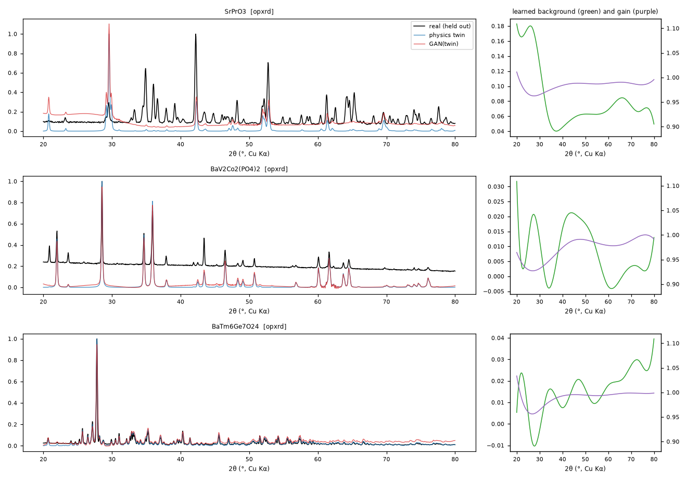
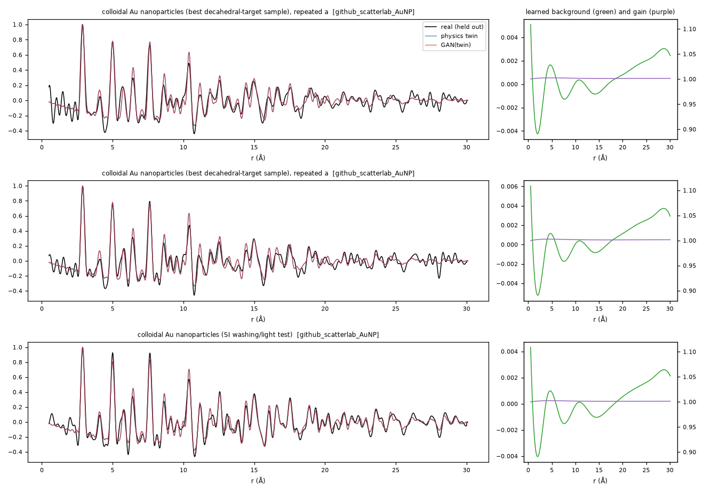
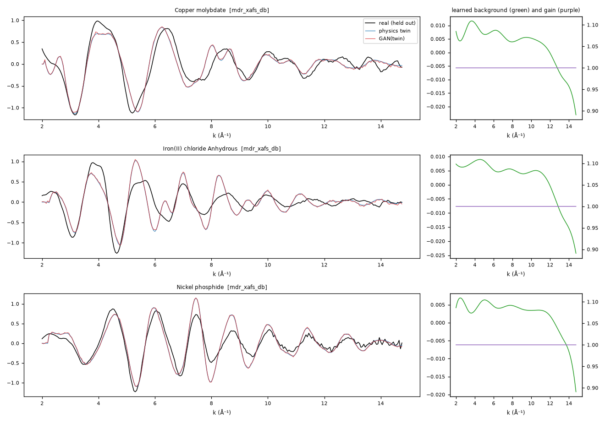

# GAN realism diagnostics

All realism numbers are measured on real spectra held out from GAN training and checkpoint selection (the 20 % evaluation split of Phase 3, items with a usable physics twin). Each real spectrum is compared with three alternatives built from its physics twin: the twin alone, the twin with classical augmentation (the baseline, variant (a)), and the twin passed through the GAN realism layer.

## Method

- **C2ST:** a classifier two-sample test. Gradient-boosted trees (scikit-learn `HistGradientBoostingClassifier`, 150 iterations, 15 leaves) separate real from alternative spectra, using spectrum, derivative and log power-spectrum features, with 5-fold cross-validation. 50 % means indistinguishable; 100 % means perfectly separable. The minimum leaf size is max(2, min(20, training fold / 10)); with the library default of 20, the trees cannot split at all on the 10 held-out PDFs.
- **Fréchet distance:** computed in the embedding space of the technique's encoder from predictor (a), seed 1, which never saw GAN output. Embeddings are projected onto their first d principal components, d = min(32, n/3), so each covariance has at least 3 samples per dimension. Lower is closer to real.
- **Diversity:** 64 fixed inputs, 16 latent draws each. The mean pairwise L2 distance between draws (relative to the input norm) and the variance of each learned artifact field across draws.
- **Label preservation:** 500 Concord Forge test spectra are fitted with standard tools before and after the realism layer, using the same tool and starting values:
  - XRD: lmfit, fcc (111)+(200) with Kα2 → lattice parameter.
  - PDF: diffpy.pdffit2, fcc with spherical envelope → lattice parameter and diameter.
  - EXAFS: xraylarch feffit, first shell → N and R.

  A spectrum **fails** if a fitted label moves by more than the tolerance between the two fits. "Recovery" is reported separately: how often each fit lands within an absolute tolerance of the simulation's label. It measures the fitting model itself, for example a single-path EXAFS fit applied to the mixed Pt–Pt/Pt–M first shell of an alloy.

## Summary

| Technique | held-out real | C2ST twin | C2ST classical | C2ST GAN | FD twin | FD classical | FD GAN | label-preservation failures |
|---|---|---|---|---|---|---|---|---|
| XRD | 55 | 0.845 | 0.809 | 0.664 | 58.5 | 51.6 | 61 | 1.4 % (7/500) |
| PDF | 10 | 0.950 | 0.800 | 0.950 | 201 | 195 | 200 | 2.4 % (12/500) |
| EXAFS | 74 | 0.946 | 0.919 | 0.906 | 82.3 | 167 | 82.9 | 0.0 % (0/500) |

## Training runs and checkpoint selection

Every 2,000 steps the EMA generator was scored on the **validation** split: score = |C2ST − 0.5| + 0.05 × (artifact-feature Fréchet distance of GAN output ÷ that of the raw twins). The C2ST here is the faster logistic-regression version used during training. The checkpoint with the lowest score was kept. Training stopped after 6 checkpoints without an improvement of at least 0.005. For PDF and EXAFS, the first run's discriminator won outright (hinge loss below 0.05), so a second run with stronger R1 regularization (γ = 10 instead of 1) was trained. The run with the better validation score was kept. The held-out evaluation split was not used for any of these choices.

| Technique | Run | R1 γ | Best step | Stopped at | Validation C2ST at best | Feature-FD ratio at best | Shipped |
|---|---|---|---|---|---|---|---|
| XRD | 1 | 1 | 14000 | 26000 | 0.637 | 0.36 | yes |
| PDF | 1 | 1 | 4000 | 16000 | 1.000 | 12.87 | no |
| PDF | 2 | 10 | 2000 | 14000 | 1.000 | 2.36 | yes |
| EXAFS | 1 | 1 | 2000 | 14000 | 0.917 | 26.28 | no |
| EXAFS | 2 | 10 | 2000 | 14000 | 0.932 | 6.21 | yes |

For PDF and EXAFS, the best checkpoint is an early one (step 2,000). Later in training the discriminator kept improving, and the generator's artifact statistics drifted away from the real ones; the feature-FD ratio grew by one to two orders of magnitude. Early stopping therefore selected generators that add modest, realistic-scale artifacts.

## XRD

Held-out real spectra: 55. Fréchet dimension d = 18.

| Alternative compared with real | C2ST accuracy | fold std | Fréchet distance |
|---|---|---|---|
| simulated twin, no artifacts | 0.845 | 0.084 | 58.5 |
| twin + classical augmentation | 0.809 | 0.045 | 51.6 |
| twin + GAN realism layer | 0.664 | 0.102 | 61 |

**Realism:** by C2ST, the GAN output is closer to real than the raw twins and closer than classical augmentation. By Fréchet distance it is not closer than the raw twins and not closer than classical augmentation.

**Diversity:** 16 latent draws for the same input differ by 0.0825 of the spectrum norm (mean pairwise distance). Variance across draws: background 2.24e-05, gain 1.79e-06, noise scale 3.4e-07 (no sign of mode collapse).

**Label preservation** (500 spectra; tolerance {'a': 0.005}):

- **Failure rate:** 1.4 %, counting a fit failure of either spectrum as a failure. Fits failed on 0 clean spectra and on 0 more after the realism layer.
- **Among the 500 spectra where both fits converged:** 1.4 % moved a label beyond tolerance.
- **Recovery of the simulation's label:** 79.2 % of clean fits and 78.8 % of fits after the realism layer.

## PDF

Held-out real spectra: 10. Fréchet dimension d = 3.

**Low power:** with only 10 held-out real spectra, C2ST accuracies have fold standard deviations of tens of percentage points, and the Fréchet distance uses very few dimensions. Treat these numbers as indicative only.

| Alternative compared with real | C2ST accuracy | fold std | Fréchet distance |
|---|---|---|---|
| simulated twin, no artifacts | 0.950 | 0.100 | 201 |
| twin + classical augmentation | 0.800 | 0.100 | 195 |
| twin + GAN realism layer | 0.950 | 0.100 | 200 |

**Realism:** by C2ST, the GAN output is not closer to real than the raw twins and not closer than classical augmentation. By Fréchet distance it is closer than the raw twins and not closer than classical augmentation.

**Diversity:** 16 latent draws for the same input differ by 0.0118 of the spectrum norm (mean pairwise distance). Variance across draws: background 7.34e-08, gain 2.64e-08, noise scale 1.26e-08 (no sign of mode collapse).

**Label preservation** (500 spectra; tolerance {'a': 0.005, 'd_rel': 0.1}):

- **Failure rate:** 2.4 %, counting a fit failure of either spectrum as a failure. Fits failed on 12 clean spectra and on 0 more after the realism layer.
- **Among the 488 spectra where both fits converged:** 0.0 % moved a label beyond tolerance.
- **Recovery of the simulation's label:** 80.8 % of clean fits and 80.8 % of fits after the realism layer.

## EXAFS

Held-out real spectra: 74. Fréchet dimension d = 24.

| Alternative compared with real | C2ST accuracy | fold std | Fréchet distance |
|---|---|---|---|
| simulated twin, no artifacts | 0.946 | 0.055 | 82.3 |
| twin + classical augmentation | 0.919 | 0.050 | 167 |
| twin + GAN realism layer | 0.906 | 0.039 | 82.9 |

**Realism:** by C2ST, the GAN output is closer to real than the raw twins and closer than classical augmentation. By Fréchet distance it is not closer than the raw twins and closer than classical augmentation.

**Diversity:** 16 latent draws for the same input differ by 0.0416 of the spectrum norm (mean pairwise distance). Variance across draws: background 1.32e-06, gain 1.57e-10, noise scale 8.37e-07 (no sign of mode collapse).

**Label preservation** (500 spectra; tolerance {'N_rel': 0.1, 'R': 0.01}):

- **Failure rate:** 0.0 %, counting a fit failure of either spectrum as a failure. Fits failed on 0 clean spectra and on 0 more after the realism layer.
- **Among the 500 spectra where both fits converged:** 0.0 % moved a label beyond tolerance.
- **Recovery of the simulation's label:** 51.2 % of clean fits and 51.2 % of fits after the realism layer.

## Limitations

- **The real reference data are mostly not Pt nanoparticles.**
  - XRD: opXRD laboratory patterns of many inorganic phases, plus a few dozen Pt and Pt–Co catalyst patterns.
  - EXAFS: reference compounds and catalysts from open XAS databases, at several edges.
  - PDF: colloidal Au nanoparticles from one self-driving-lab campaign.

  The realism models learn instrument and processing artifacts of these sources, not of Pt nanoparticles as such.
- **The physics twins are approximations of the measured materials:** a labelled structure for opXRD, bulk FEFF for EXAFS, and a Debye-simulated particle for PDF. Content differences between twin and real spectrum (phase impurities, structure, disorder) cannot be removed by an artifacts-only generator, and they dominate the C2ST: even the best alternative stays well above 50 %.
- **Small held-out sets:** 55 XRD, 10 PDF and 74 EXAFS spectra. Fold-to-fold standard deviations of the C2ST are 4–10 percentage points, and the PDF numbers are indicative only.
- **C2ST and Fréchet distance can disagree.** The C2ST sees the spectrum directly, including backgrounds and noise. The Fréchet distance sees only what the predictor's encoder represents, which is trained to ignore artifacts.

